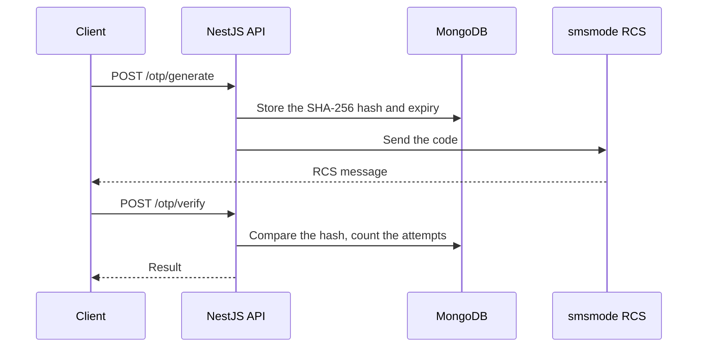

# OTP RCS Generator

A two-factor authentication backend that sends 6-digit codes over RCS. **4th place** at an inter-school hackathon, built in 4 days by a team of 4.

My part: backend and application security.

## How it works



## Security

- Codes come from `crypto.randomInt`, and only their SHA-256 hash is stored.
- A code is valid for 5 minutes, with 3 attempts at most.
- Requests are limited per phone number and per IP address.
- A code is deleted once it is verified or expired.

## Stack

NestJS · TypeScript · MongoDB (Mongoose) · smsmode RCS API · Docker Compose · Swagger

## Run it

```bash
cd hackaton-smsmode
cp .env.example .env
docker compose up
```

Fill in `.env` first: sending a code needs a smsmode API key. Swagger is available on `/api`. More details are in the [project README](hackaton-smsmode/README.md).

## Limits

This is a hackathon project, not ready for production. It still has debug endpoints, `GET /otp` and `DELETE /otp`, which would have to be removed.
